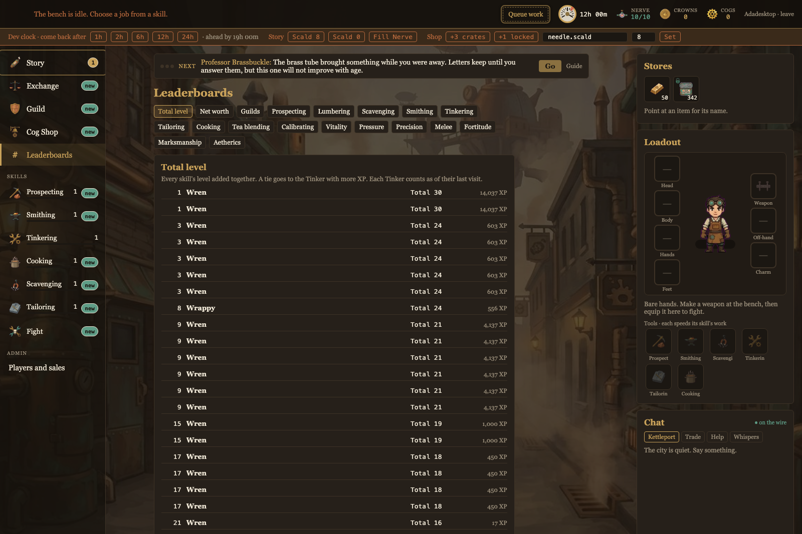
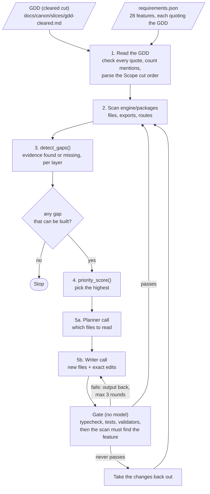

# The Long Boil builder

A goal-oriented coding agent for **The Long Boil**. It reads the game design document, scans the engine's code, works out which features the GDD asks for that the code does not have, ranks them, writes the top one, and scans again.

Its goal is one sentence: *every feature the GDD asks of the engine exists in the engine.*

On 10 November 2026 it built the game's **Leaderboards**. They are in the game: `engine/packages/server/src/leaderboards.ts`, its tests, and `engine/packages/client/src/Leaderboards.tsx`.



## What the agent built

GDD section 6, Leaderboards: "Total level, each skill, net worth, and guilds", and no story leaderboard.

| Layer | What it wrote |
| --- | --- |
| Server | `leaderboards.ts`: 19 boards (total level, net worth, guilds, and the sixteen skills) ranked from the existing tables, with no migration. It can answer all 19, but a skill gets a tab only once an action in the content trains it (a change I made by hand, below). Equal scores share a rank. Each reply holds the top 100 and the caller's own row wherever it falls. A fully banned account never appears and does not count toward its guild. |
| Route | `GET /tinkers/:id/leaderboards/:board` in `api.ts`, behind the same sign-in check as the other Tinker routes |
| Tests | `leaderboards.test.ts`: six tests through the API against a real PostgreSQL database |
| Client | `Leaderboards.tsx`, the screen; `api.leaderboard` and its types in the client's `api.ts`; a row in the side navigation |

It also listed ten choices the GDD does not settle, each with what it chose (`sample-run/report.json`). The ones I most need to decide: net worth is Crowns plus unbound goods at the collectors' price, with Gilded Cogs left out; guilds rank by their members' total levels added together; boards are per Tinker, not per account.

## Why the agent chose it

The scan found 19 of 28 requirements met and 9 gaps. Five of those could not be picked: four are held (Calibrating is parked on a branch, the Gazette needs an agent that is not built, NPC sell orders need the draftsman's prices, cosmetics wait for art) and guild charters wait on Guild Contracts. `priority_score()` ranked the other four:

```
MISSING  leaderboards       score  7.00 = (3x3 value + 5 mentions + 2x0 unlocks + 3x0.00 progress) / 2 effort
MISSING  commonplace_book   score  3.67 = (3x3 value + 2 mentions + 2x0 unlocks + 3x0.00 progress) / 3 effort
MISSING  combat_triggers    score  2.25 = (3x2 value + 3 mentions + 2x0 unlocks + 3x0.00 progress) / 4 effort
MISSING  guild_contracts    score  2.00 = (3x3 value + 5 mentions + 2x1 unlocks + 3x0.00 progress) / 4 effort / 2 (on the GDD's cut list)
next: leaderboards (Leaderboards), score 7.0
```

Leaderboards won for three reasons the score makes visible:

- **The GDD leans on it.** It names leaderboards five times, in the win condition and in month three as well as in its own section.
- **It is the smallest job.** It reads tables that already exist, so effort is 2. The Commonplace Book is worth the same to a player but needs a new model of lore facts.
- **Nothing blocks it.** Guild Contracts carries the same worth and unlocks charters, but the GDD's Scope section lists it among the first things to cut, which halves its score.

## What I changed by hand before accepting it

The agent's code passed the gate on its first round (typecheck, all 242 tests, all validators). I then played it, and changed four things in the client. The server module, the route and the tests are exactly as the agent wrote them.

| Change | Why |
| --- | --- |
| Made Leaderboards a place in the workshop, like Guild, and removed the agent's full-screen overlay and the provider it wrapped around the workshop in `App.tsx` | The agent never asked to read `Workshop.tsx`, so it could not add a place and built an overlay instead. It said so in its summary. The overlay hid the Boiler, Nerve and chat. As a place, it also opens with the rest of the city at the visit after the Prologue, so a first session has nothing more to learn. |
| Removed the agent's seventh tab from the phone's bottom bar; on a phone the boards open from a button on the Guild tab | Six tabs already fill a phone's width |
| Skill names with two words read "Tea blending", not "Tea_blending" | The agent used `titleCase` alone |
| XP is shown as a whole number | Stored XP can carry a fraction |
| Tabs only for skills the game trains (`shownBoards`), nine now, not nineteen | Ten of the sixteen skills have no action yet, so their boards would sit empty |

Still open: the side navigation shows `#` where the Leaderboards icon will go, because that art is not drawn yet.

## How it works



**Reading the GDD.** `requirements.json` lists the features, each with its GDD section and a sentence quoted from it. The agent checks every quote against the GDD and stops if one is gone, so the list cannot drift from the design. It also takes two scoring inputs straight from the GDD: how often a feature is named, and the order in which the Scope section says features are cut. It reads the cleared cut of the GDD, like every other agent on this project, so no later reveal can reach the code.

**Gap detection.** `detect_gaps()` checks each requirement's evidence: a pattern that must appear in the rules, the server, the client or the tests. All found is *met*; some is *partial*; none is *missing*.

**Priority.** `priority_score()` is worth divided by cost:

```
worth = 3 x player_value + mentions (capped at 5) + 2 x unlocks + 3 x progress
score = worth / effort          halved if the GDD lists the feature as one to cut
score = 0                       if it is held, or waits on another gap
```

`player_value` and `effort` (1 to 5) are my judgement, in `requirements.json`. Mentions, unlocks, progress and the cut list are computed on every pass.

**Writing code.** The planner sees the GDD's words on the feature and a map of the codebase, and names up to 14 files to read. The writer gets those files and returns whole new files plus exact find-and-replace edits. Nothing is applied unless every edit matches exactly once. The agent may write only under `engine/packages`.

**The loop.** After each write the agent scans again from scratch. A feature counts as built only when the gate passes and the scan finds it. The loop stops when no gap is left, when every gap left is held or waiting, or at `--max-features`. A feature that fails three rounds is taken back out, file by file, and the loop moves on.

The agent never commits or pushes. Accepting the code is mine, after playing it.

## Run it

Requires Python 3.9+, Node.js 22, PostgreSQL, and Claude Code logged in to a Claude plan.

```bash
python3 agent/agent.py                             # read, scan, rank: no model call, nothing written
python3 agent/agent.py --build                     # build the top-ranked gap, then re-scan
python3 agent/agent.py --build --max-features 3    # keep going
```

Run today, the first command reports 20 of 28 requirements met and names the Commonplace Book as next.

## Files

| Path | What it is |
| --- | --- |
| `agent.py` | The agent: GDD reader, scanner, `detect_gaps()`, `priority_score()`, planner and writer calls, the gate, the loop |
| `requirements.json` | What the GDD asks of the engine, with the evidence for each feature |
| `sample-run/run.log` | The log of the run that built Leaderboards |
| `sample-run/report.json` | Both scans, the plan, the writer's summary and its ten open questions |
| `sample-run/leaderboards.round-1.json` | The writer's reply exactly as it came back, before my changes |
