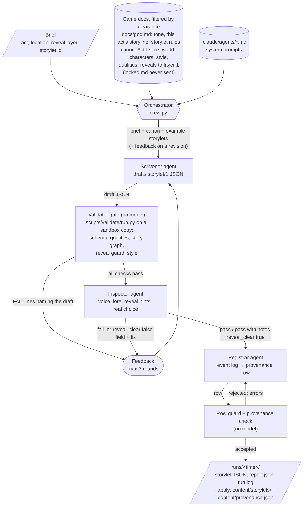

# The Long Boil content crew

A multi-agent crew that writes game-ready story content for **The Long Boil**, a steampunk idle game. It's my capstone project for ELVTR's Multi-Agent AI for Game Development course. In the game you play a Tinker in Kettleport, a city of brass and steam that floats above a boiling sea. You queue skilling actions that resolve while you're away, and you spend Nerve on storylets: short choice-driven scenes that carry the game's mystery.

## What the crew produces

Give the crew a **brief** and it returns one **storylet** as a `storylet/1` JSON file that the game engine loads directly from `content/storylets/`, plus that storylet's row in the game's provenance register (`content/provenance.json`). A brief names the act, the location, the reveal layer the writer is cleared for, and what the scene must do. A storylet is a scene with a description, two to four options, skill challenges, and outcomes that change the player's qualities (items, Needles, Favour).

The output is game-ready because the crew doesn't stop until:

- every one of the game's own validators passes on it: schema, quality references, story-graph reachability, the reveal guard, house style and word limits, and the provenance check;
- the Inspector agent has given it a verdict other than fail, and found nothing that states or hints at a fact above the brief's reveal layer;
- the Registrar agent has written a register row that the provenance schema accepts.

Three storylets made with it, and what the Inspector caught along the way, are in [`outputs/`](outputs/README.md). The sample brief, `briefs/rustmoor-silk-storylet.md`, asks for a Rustmoor scene that ties the Rust Rats' umbrella silk to the new Tailoring skill (the game's work order 032).

## The agents

| Agent | Model | Job | Writes |
| --- | --- | --- | --- |
| **Scrivener** | Claude Opus 5.5, high effort | Drafts the storylet in the house voice from the brief and the Act I canon. Revises it from validator and Inspector feedback. | `storylet_json`, things it invented, open questions |
| **Validator gate** | No model: the game's `scripts/validate/run.py` | Runs every content check on a sandbox copy of the game's content with the draft dropped in. | Pass, or the exact failure lines |
| **Inspector** | Claude Opus 5.5, high effort | Reviews what code can't check: voice, lore, reveal hints, whether the choice is a real one, economy risk. Never edits. | `pass` / `pass with notes` / `fail`, with field-level fixes |
| **Registrar** | Claude Opus 5.5, low effort | Turns the run's event log into one provenance row, up to status `reviewed`. Never approves. | The register row |

Each agent's system prompt is its definition in `../.claude/agents/`. The same six agent definitions run the game's build crew inside Claude Code, so this crew is the storylet slice of that pipeline, rebuilt as standalone orchestration code.

**What the agents read.** Before drafting, every agent reads the game's design document, `docs/gdd.md`, but only three sections of it: Tone and voice, its own act's storyline, and the Storylet rules with the challenge-odds formula. It also reads the canon bible drawn from the GDD. An agent gets only the canon its act is cleared for: the Act I slice, `world.md`, `characters.md`, `style.md`, `qualities.json`, and `reveals.md` truncated at the brief's layer. `docs/canon/locked.md` (the late-game twist) is excluded in code and is never copied into the sandbox, and the GDD's own list of every reveal layer is never sent.

**Hard guards in code.** The orchestrator rejects any register row that names the wrong id, sets `approved_by`, or goes past `reviewed`. Approval belongs to the designer, after playing the build.

## Diagram



Data flow, in words: the orchestrator hands each agent only what that agent needs. The Scrivener's draft goes through deterministic validation before any model reviews it, so the Inspector spends its attention only on what code can't decide. Failures from either step go back to the Scrivener as specific feedback, for at most three rounds. A reveal risk sends the draft back even when the Inspector would otherwise pass it, because in this game a hint at a later reveal counts as a leak. The Registrar sees only the event log (who drafted, which checks passed, the Inspector's verdict), and its row is itself checked by the register's schema before the run counts as done.

## Run it

Requires Python 3.10+, and either an Anthropic API key or Claude Code logged in to a Claude plan.

```bash
cd crew
uv venv .venv && uv pip install --python .venv/bin/python -r requirements.txt
# or: python3 -m venv .venv && .venv/bin/pip install -r requirements.txt

export ANTHROPIC_API_KEY=sk-ant-...
.venv/bin/python crew.py briefs/rustmoor-silk-storylet.md            # real run, API key
.venv/bin/python crew.py briefs/rustmoor-silk-storylet.md --claude-code  # real run, Claude plan
.venv/bin/python crew.py briefs/rustmoor-silk-storylet.md --apply    # and add it to the game
.venv/bin/python crew.py briefs/rustmoor-silk-storylet.md --dry-run  # no API key needed
```

`--claude-code` sends each agent's call through headless Claude Code (`claude -p`) with the same system prompt and output schema, no tools and no project settings, so it runs on a Claude subscription instead of API credits (`claude_code_client.py`).

`--dry-run` replaces the three models with canned replies (`dry_run.py`) and runs everything else for real, validators included. The canned first draft contains a banned phrase on purpose, so you can watch the gate send it back:

```
-- round 1
[scrivener] thinking (high effort)
[gate] 1 validator failure(s), back to the scrivener
[gate]   FAIL style/banned content/storylets/act1.rustmoor.silk_line.json id=act1.rustmoor.silk_line : /description contains 'a sense of' (banned: 'a sense of')
-- round 2
[gate] validators pass (12 checks)
[inspector] verdict: pass with notes
[registrar] row written at status reviewed; provenance check passes
```

## A real run

`sample-run/` is the output of a real run on 2 November 2026 (Claude Opus 5.5 through `--claude-code`), committed as it came out:

```
08:20:52 brief crew/briefs/rustmoor-silk-storylet.md: act1.rustmoor.silk_line, act 1, layer 1
08:20:52 -- round 1
08:20:52 [scrivener] thinking (high effort)
08:22:00 [scrivener] done: 11760 in, 6988 out
08:22:01 [gate] validators pass (12 checks)
08:22:01 [inspector] thinking (high effort)
08:22:55 [inspector] done: 11320 in, 5699 out
08:22:55 [inspector] verdict: pass with notes
08:22:55 [registrar] thinking (low effort)
08:23:11 [registrar] done: 5187 in, 1770 out
08:23:11 [registrar] row written at status reviewed; provenance check passes
```

- [`sample-run/act1.rustmoor.silk_line.json`](sample-run/act1.rustmoor.silk_line.json): the storylet. Pickers air umbrella silk on a line at the tip while the Rust Rats watch. Three options: a Tailoring challenge for Quilted Silk, a Scavenging raid on a rats' nest for Umbrella Silk, or a safe watch for one scrap.
- [`sample-run/report.json`](sample-run/report.json): the eight things the Scrivener invented and flagged, its open questions, the Inspector's reveal and economy risks and four field-level findings, and the register row.

The run was not applied to the game. It waits at `reviewed` for the designer's read.

Each run writes `runs/<timestamp>/`: the storylet file, `report.json` (anything the Scrivener invented, its open questions, the Inspector's verdict, and the register row) and `run.log`.

## Files

| Path | What it is |
| --- | --- |
| `crew.py` | The orchestrator: context assembly, the three agents, the validator gate, the revision loop, the row guard. |
| `claude_code_client.py` | Runs the agents through headless Claude Code for `--claude-code`. |
| `dry_run.py` | Canned agent replies for `--dry-run`. |
| `sample-run/` | The output of a real run. |
| `briefs/` | Briefs the crew can take. |
| `fixtures/` | The canned storylet the dry run uses. |
| `../.claude/agents/` | The agent definitions used as system prompts. |
| `../scripts/validate/` | The game's validators, used as the gate. |
| `../docs/canon/` | The canon bible the agents draw from. |
