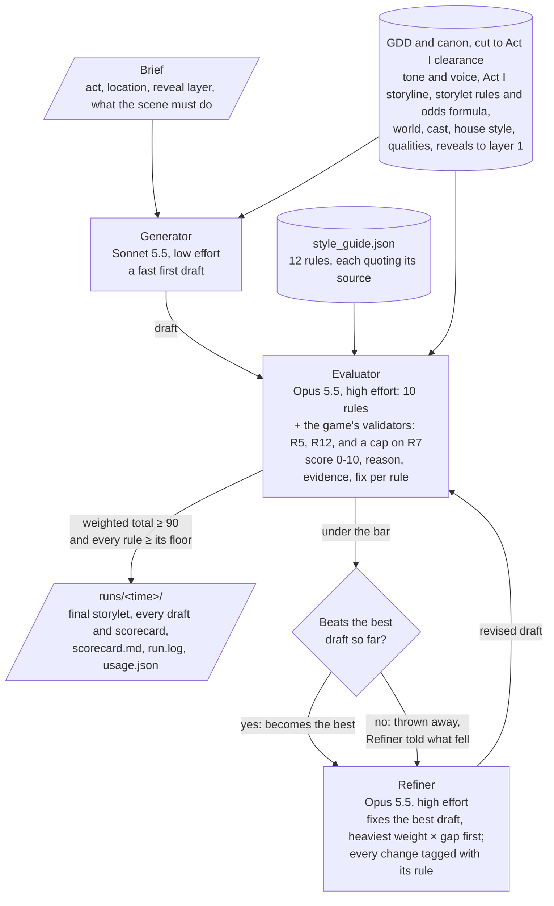

# The style loop: Generator → Evaluator → Refiner

An automated, self-correcting loop that writes a storylet for **The Long Boil** and holds it to the game's own house style until it scores. It's an assignment for my capstone in ELVTR's Multi-Agent AI for Game Development course.

The Long Boil is a steampunk idle MMO. Kettleport, a city of brick and brass, has ridden a column of steam above the Scald, a boiling sea, for 312 years. You are a Tinker who inherits No. 9 Sprocket Row from Hester Vane, who vanished. A storylet is a short scene with two or three options, which the player spends Nerve to play. This loop writes one.

```bash
python3 refine/loop.py refine/briefs/polytechnic-basement-supper.md            # real run, on the Claude plan through headless Claude Code
python3 refine/loop.py refine/briefs/polytechnic-basement-supper.md --dry-run  # canned agents, real validators, no model calls
python3 refine/loop.py --guide                                                 # rewrite STYLE_GUIDE.md from style_guide.json
```

## How each constraint is met

| Constraint | How |
| --- | --- |
| **No new universe.** The style guide comes from the GDD. | [`style_guide.json`](style_guide.json) holds 12 rules. Each one names its source and quotes it: the GDD's Tone and voice section (via `docs/canon/style.md`), the world and cast (GDD sections 2 and 3), and the Act I reveal limits (GDD section 4). The agents also read those sections of the GDD and canon directly, loaded by the same code the game's content crew uses (`crew/crew.py`, `canon_bundle`). Readable version: [`STYLE_GUIDE.md`](STYLE_GUIDE.md). |
| **No generic content.** A stranger can tell which game this is. | The rules only make sense in Kettleport. Nothing may live below the city, because "Nobody alive has seen the ground" (R8). No Haze, no off-hour Whistle note and no heat up the Downpipe in Act I, because those are later reveals (R7). Scenes must read true whether the Tinker was Hester's apprentice, her relative or a stranger (R11). Pip never finishes a sentence (R9). Challenge odds are checked with the GDD's own formula (R10). |
| **No binary pass/fail.** The Evaluator gives a score and a reason. | Every rule gets a score from 0 to 10, a reason, the exact words that cost points (with their field), and a fix. Weights sum to 100. A draft is accepted at a weighted total of 90, with every rule at or above its floor. Two rules are scored by the game's real validators rather than a model: R5 (word limits, banned words) and R12 (schema, qualities, story graph). |
| **No intervention.** The loop finds and fixes violations on its own. | After the first command, nobody steps in. The Refiner reads the scorecard and fixes the heaviest problems first. Each revision is scored fresh by the Evaluator, which does not see earlier scores. A revision that scores lower than the best so far is thrown away, and the Refiner is told which rules it broke. The loop stops when a draft is accepted, or after 5 refinements with its best draft. |

## The loop



Why each agent sits where it does:

- **The Generator is the scrivener's own definition** (`.claude/agents/scrivener.md`) on a fast model at low effort. The first pass is cheap and fast, and the loop is built to catch what that misses.
- **The Evaluator judges and never writes.** It works against fixed anchors (what a 10, a 5 and a 0 look like for each rule), so a score means the same thing in every iteration.
- **The Refiner edits; it does not redraft.** It changes as little as it can and leaves alone any sentence nobody objected to, so a fix for one rule does not break another.
- **Code scores what code can decide.** A model's opinion never overrides a validator failure. A reveal-validator failure caps R7 at 3, so that draft cannot be accepted.

## The rules

| | Rule | Weight | Floor | Source |
| --- | --- | ---: | ---: | --- |
| R1 | Second person, present tense | 10 | 7 | GDD §2 via `style.md` |
| R2 | Short and specific ("A No. 4 spanner beats an old tool") | 10 | 7 | GDD §2 via `style.md` |
| R3 | Grim and funny in the same breath; dry wit over gore; never explain the joke | 10 | 7 | GDD §2 via `style.md` |
| R4 | Victorian register without pastiche | 5 | 7 | GDD §2 via `style.md` |
| R5 | House limits and banned words (*code*) | 10 | 10 | `style.md`, `check_style.py` |
| R6 | Nobody explains the mystery | 5 | 7 | GDD §2 via `style.md` |
| R7 | Reveal clearance: Layer 1 and the Act I hard limits | 15 | 9 | GDD §4 via the Act I slice |
| R8 | Kettleport canon, not generic fantasy | 10 | 7 | GDD §2 via `world.md` |
| R9 | Cast speak in their own voice and know only what they know | 5 | 7 | GDD §3 via `characters.md` |
| R10 | A real choice, with honest odds | 10 | 7 | `style.md` Options, GDD odds formula |
| R11 | True for every origin | 5 | 7 | `characters.md`, The Tinker |
| R12 | Game-ready data (*code*) | 5 | 10 | `scripts/validate/run.py` |

R7 carries the most weight. In this game a hint at a later reveal is the costliest mistake: it spoils the mystery the whole story runs on.

## A real run

[`sample-run/`](sample-run/) is a real run from 26 November 2026, committed as it came out. The brief, [`briefs/polytechnic-basement-supper.md`](briefs/polytechnic-basement-supper.md), fills a real gap in the game: Cooking is a day-one skill, but no Polytechnic storylet challenges it.

| Rule | It. 0 (Generator) | It. 1 (Refiner) |
| --- | ---: | ---: |
| R1 Second person, present tense | 9 | 9 |
| R2 Short and specific | 8 | 9 |
| R3 Grim and funny | 8 | 8 |
| R4 Victorian register | 9 | 10 |
| R5 Limits and banned words (code) | 10 | 10 |
| R6 Mystery unexplained | 10 | 9 |
| R7 Reveal clearance | 10 | 10 |
| R8 Kettleport canon | **7** (at its floor) | 9 |
| R9 Cast voice | 10 | 10 |
| R10 Real choice, honest odds | 8 | 9 |
| R11 True for every origin | 10 | 10 |
| R12 Game-ready data (code) | 10 | 10 |
| **Total** | **89.5**, under the bar | **93.5**, accepted |

**What the Evaluator caught in the first draft** (from [`score-0.json`](sample-run/score-0.json)):

- **R8, canon:** "world.md says first-years build the boilers and a qualified hand must test each one. The draft says the first-years are doing the testing, which goes against that detail and against the draft's own first sentence." It also noted that a stew wrapped as leftovers was paid out as the existing Rustmoor ration item, so the text and the item did not match.
- **R10, choice:** it worked the odds formula: "Cooking 3 gives 26% ... 8 gives 69%. The average is about 47%, so it meets the brief's 'about half'." But "the salt-pork option is weak: it spends 2 pork for 1 ration, while the free challenge offers 2 rations at even odds."
- **R3, wit:** "one tag explains the joke about the margin note." The GDD bans "any sentence that explains its own joke".
- **R1, tense:** one outcome jumps "a week ahead mid-scene", out of the scene's now.
- **R2, specific:** "a row of hollow-eyed faces" is stock and "of better days" is padding.

**What the Refiner changed** (from [`changes-1.json`](sample-run/changes-1.json); every change names its rule):

| Rule | Before | After |
| --- | --- | --- |
| R8 | The first-years are still testing. | The tester has not come down, and the first-years will not leave their boilers. |
| R2 | a row of hollow-eyed faces turns toward you | six first-years in scorched aprons turn toward you |
| R3 | ...in the margin of a pressure table, for reasons of gratitude. | ...in the margin of a pressure table. |
| R10 | Fry two cuts of your salt pork, and take a ration... (+1 ration) | ...and accept two rations in the bench's thanks. (+2 rations) |
| R1 | The smell is brought up in a lecture the following week... | Somebody notes the smell as an example of incomplete combustion. |
| R4 | wrapped in a lab sheet | wrapped in a page of laboratory notes |

The re-score accepted it at 93.5 out of 100. Even then, the Evaluator did not give it 10s across the board. It flagged that the Refiner had copied the style guide's own example: "The 'No. 4 spanner' is the style guide's own example copied word for word, so it reads as ticking a box rather than as something seen." It also flagged that "a page of laboratory notes" at the Polytechnic might read as a Hester fragment. Both notes are in [`scorecard.md`](sample-run/scorecard.md) for the designer. The final storylet is [`sample-run/act1.polytechnic.basement_supper.json`](sample-run/act1.polytechnic.basement_supper.json).

Cost: 4 agent calls, about 3 minutes, $0.86 at API list prices, billed to the Claude plan.

## A run that takes more than one pass

[`sample-dry-run/`](sample-dry-run/) is `--dry-run`. The canned Generator's draft has five planted flaws: "the player" and "a sense of" (the real style validator catches both), a past-tense sentence, a modern "Okay", and whale oil in a world with nothing alive below it. The canned Refiner fixes only the two heaviest rules per pass, so the loop takes two refinements to reach acceptance:

| Rule | It. 0 | It. 1 | It. 2 |
| --- | ---: | ---: | ---: |
| R1 Second person, present tense | **6** | 10 | 10 |
| R4 Victorian register | **6** | **6** | 10 |
| R5 Limits and banned words (code) | **4** | 10 | 10 |
| R8 Kettleport canon | **6** | **6** | 10 |
| **Total** | 84.0 | 94.0 | 100.0 |

Iteration 1 scores 94, above the bar, but it is still not accepted: R4 and R8 are under their floors. A high average cannot hide a single broken rule.

## Files

| Path | What it is |
| --- | --- |
| `loop.py` | The loop: the three agents, the scoring, the regression guard, and the run's files |
| `style_guide.json` | The 12 rules: weight, floor, source, quote, what to check, and score anchors |
| `STYLE_GUIDE.md` | The same rules as the agents read them, generated from the JSON |
| `briefs/` | Briefs the loop can take |
| `fake_agents.py`, `fixtures/` | The canned agents and the flawed draft for `--dry-run` |
| `sample-run/`, `sample-dry-run/` | The two runs above |
| `../crew/crew.py` | Reused: canon loading cut to clearance, the sandboxed validator gate, the agent caller |
| `../crew/claude_code_client.py` | Reused: runs each agent through `claude -p` on the Claude plan (`--api` uses API credits instead) |

The loop never writes to `content/`. A storylet it accepts enters the game the way every storylet does: a row in the provenance register, and the designer's approval after playing it.
